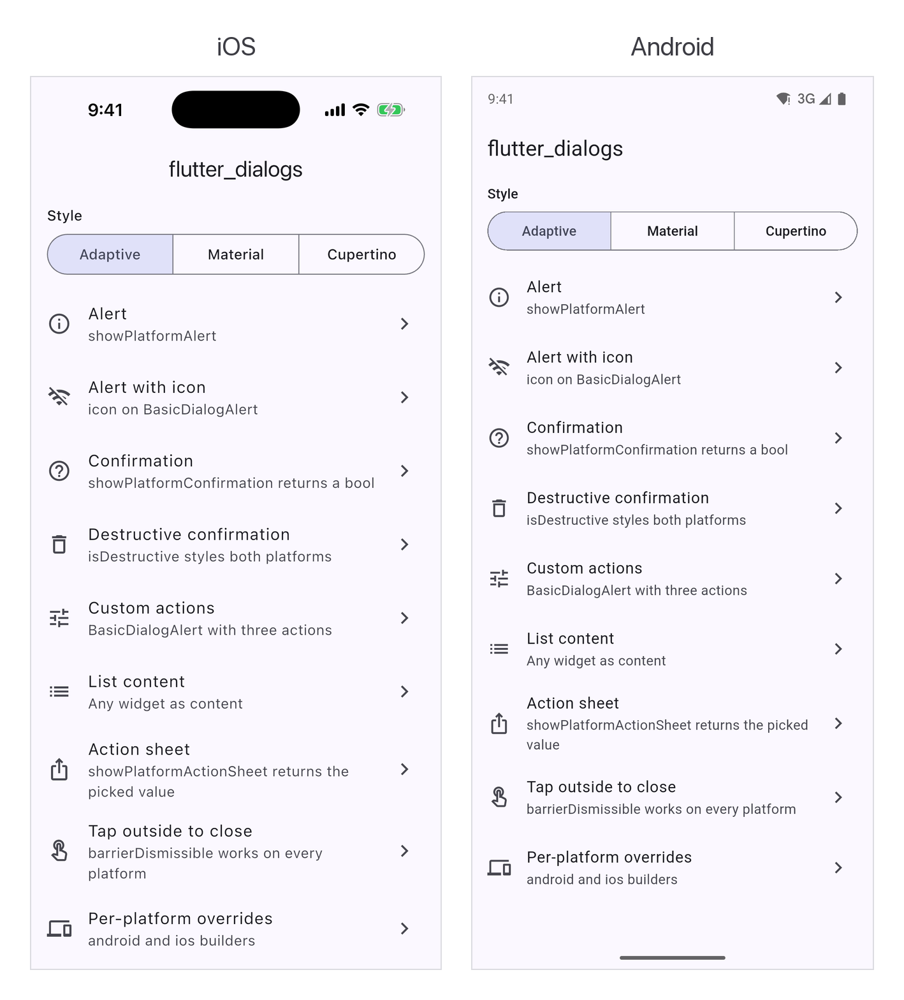
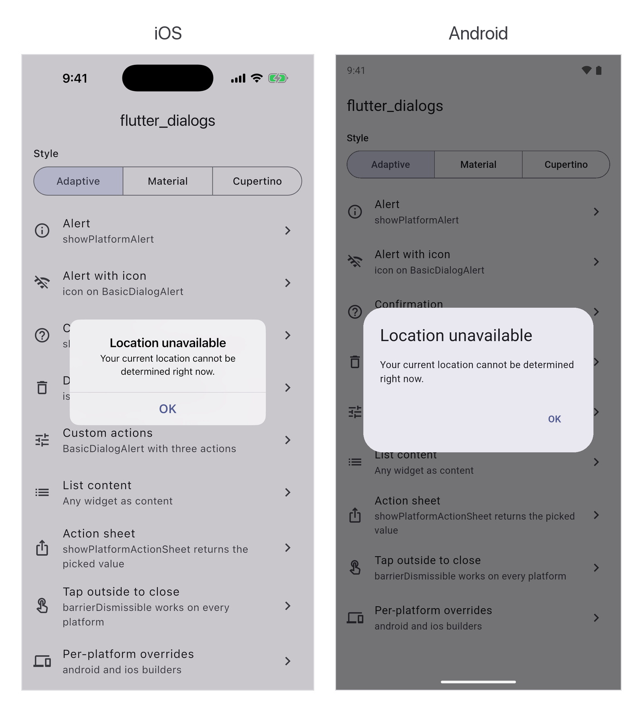
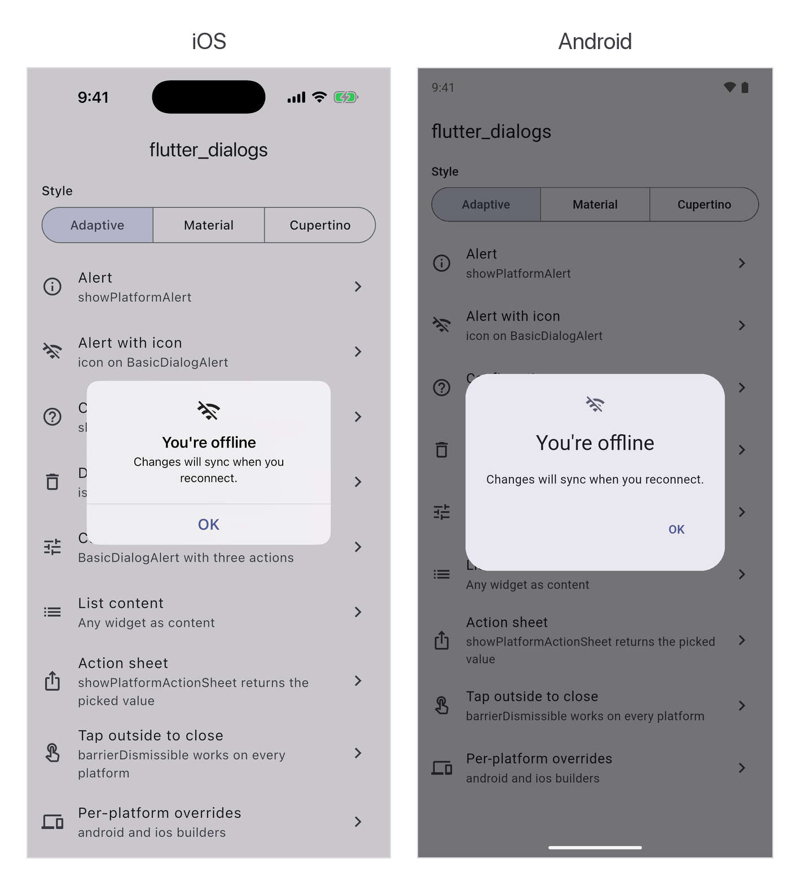
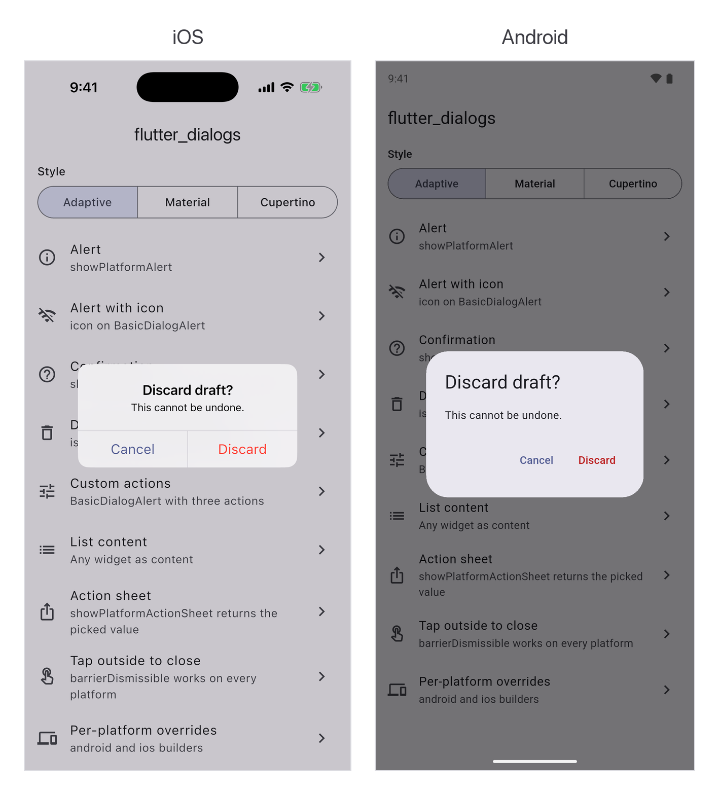
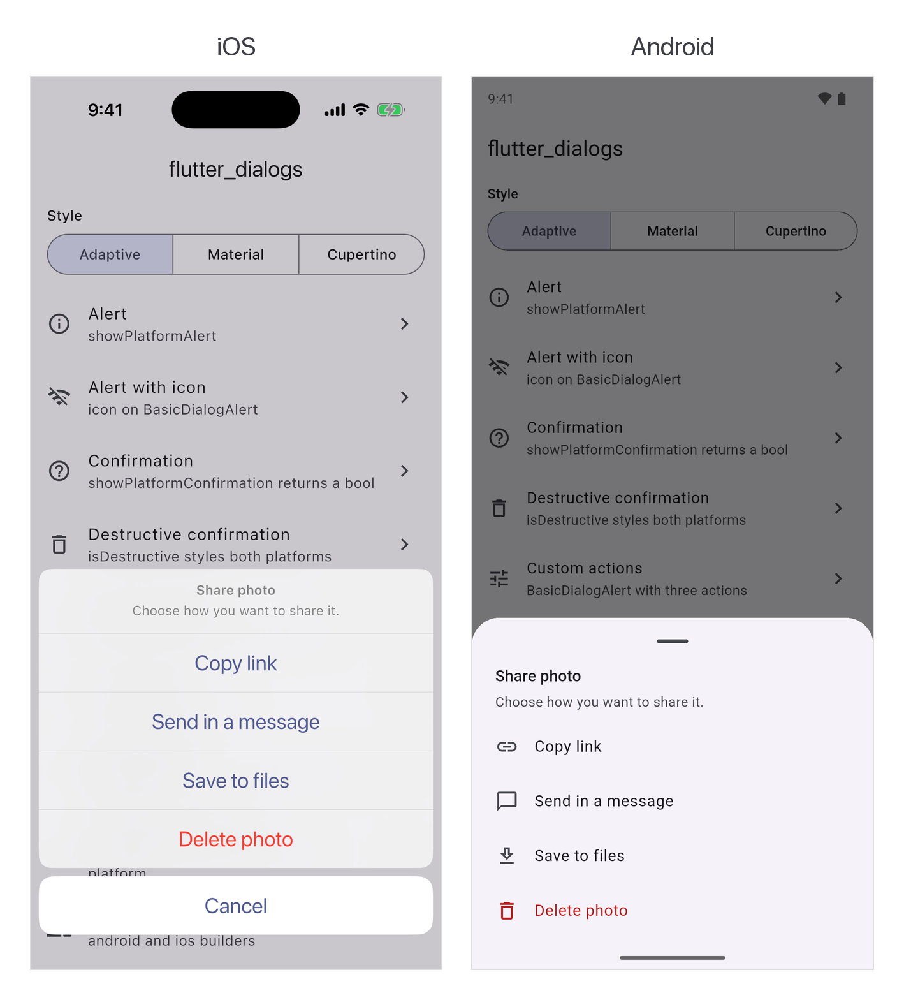
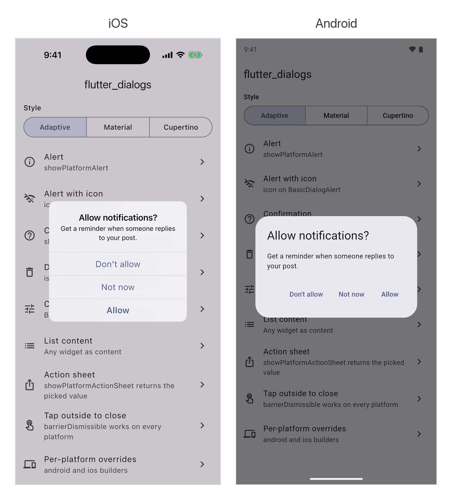
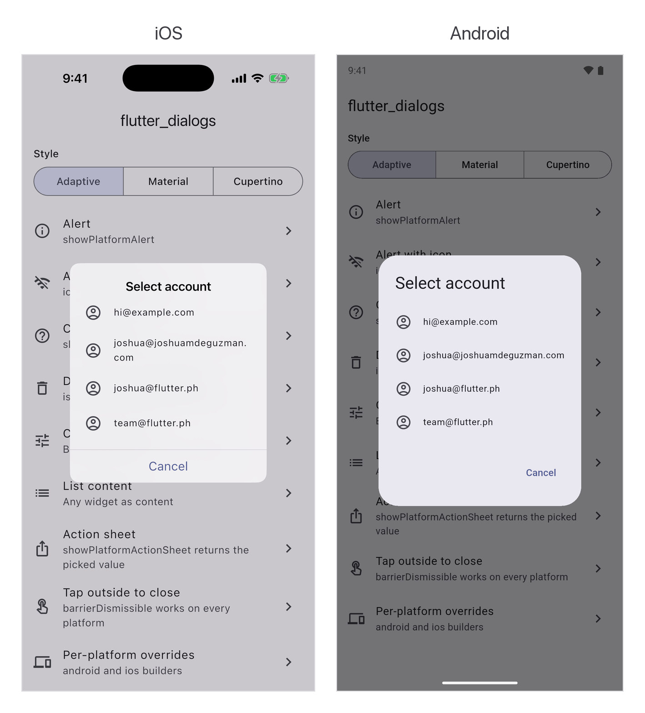
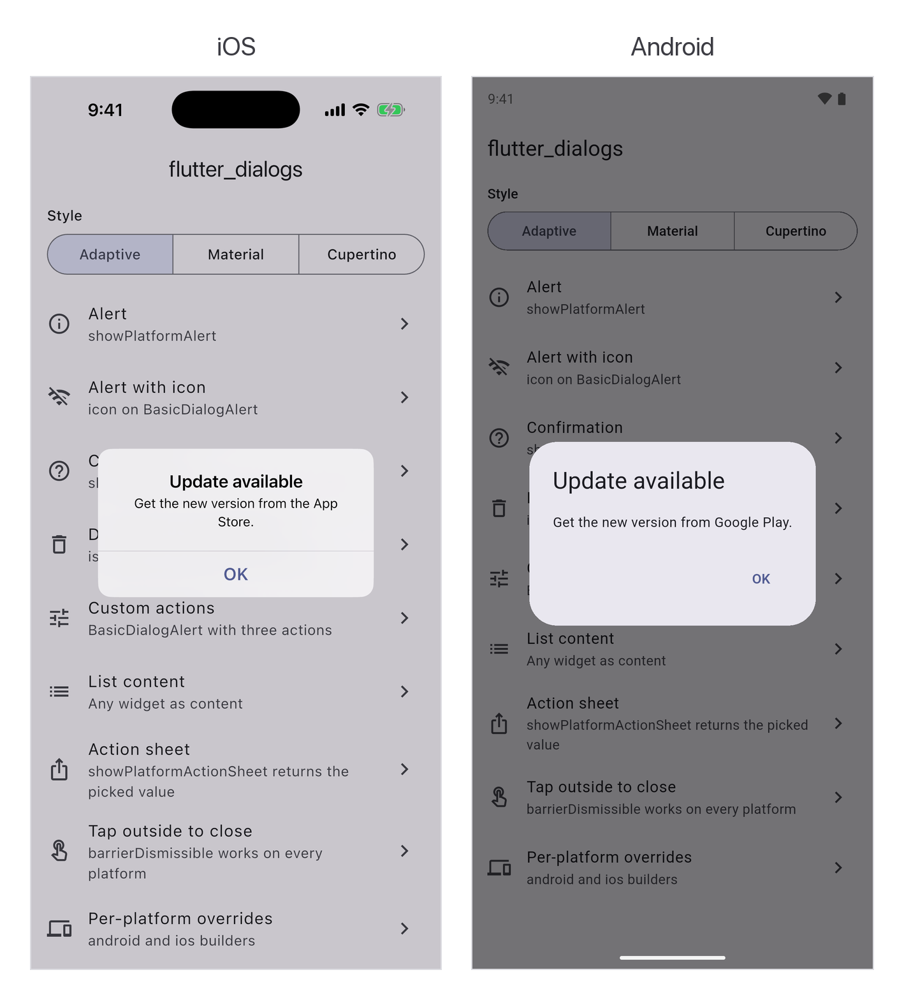

# flutter_dialogs

[](https://pub.dev/packages/flutter_dialogs)

Platform-aware dialogs, alerts, confirmations and action sheets for Flutter. Write one call and get Cupertino widgets on iOS and macOS, and Material widgets everywhere else.



## Features

- **Platform aware.** Cupertino on iOS and macOS. Material on Android, the web, Windows and Linux.
- **Simple helpers that return results.** `showPlatformAlert`, `showPlatformConfirmation` and `showPlatformActionSheet` handle the buttons and closing for you.
- **Native action styles.** Default and destructive actions look right on both platforms.
- **Override when you need to.** Force a style, or change the title and content per platform.
- **No dependencies.** Only the Flutter SDK.

## Installation

```bash
flutter pub add flutter_dialogs
```

```dart
import 'package:flutter_dialogs/flutter_dialogs.dart';
```

Requires Dart 3.5 and Flutter 3.24 or later.

## Alert

```dart
await showPlatformAlert(
  context: context,
  title: 'Location unavailable',
  message: 'Your current location cannot be determined right now.',
);
```



Add an `icon` to show it above the title.

```dart
await showPlatformAlert(
  context: context,
  icon: const Icon(Icons.wifi_off),
  title: "You're offline",
  message: 'Changes will sync when you reconnect.',
);
```



## Confirmation

`showPlatformConfirmation` returns `true` if the user confirms, and `false` if they cancel or dismiss it. Set `isDestructive` when the action deletes or discards something.

```dart
final discard = await showPlatformConfirmation(
  context: context,
  title: 'Discard draft?',
  message: 'This cannot be undone.',
  confirmLabel: 'Discard',
  isDestructive: true,
);

if (discard) deleteDraft();
```



## Action sheet

`showPlatformActionSheet` shows a `CupertinoActionSheet` on iOS and a modal bottom sheet on Android. It returns the `value` of the option the user picks, or `null` if they cancel.

```dart
final choice = await showPlatformActionSheet<String>(
  context: context,
  title: 'Share photo',
  message: 'Choose how you want to share it.',
  actions: const [
    PlatformSheetAction(label: 'Copy link', value: 'copy', icon: Icon(Icons.link)),
    PlatformSheetAction(label: 'Send in a message', value: 'message', icon: Icon(Icons.chat_bubble_outline)),
    PlatformSheetAction(label: 'Save to files', value: 'save', icon: Icon(Icons.download_outlined)),
    PlatformSheetAction(label: 'Delete photo', value: 'delete', icon: Icon(Icons.delete_outline), isDestructiveAction: true),
  ],
);
```

Icons are shown on Material only, since iOS action sheets are text only.



## Custom dialogs

For full control, build the dialog yourself with `showPlatformDialog`, `BasicDialogAlert` and `BasicDialogAction`. Whatever you pass to `Navigator.pop` is returned.

```dart
final answer = await showPlatformDialog<String>(
  context: context,
  builder: (context) => BasicDialogAlert(
    title: const Text('Allow notifications?'),
    content: const Text('Get a reminder when someone replies to your post.'),
    actions: [
      BasicDialogAction(
        title: const Text("Don't allow"),
        onPressed: () => Navigator.of(context).pop('denied'),
      ),
      BasicDialogAction(
        title: const Text('Not now'),
        onPressed: () => Navigator.of(context).pop('later'),
      ),
      BasicDialogAction(
        isDefaultAction: true,
        title: const Text('Allow'),
        onPressed: () => Navigator.of(context).pop('allowed'),
      ),
    ],
  ),
);
```



The content can be any widget, such as a list.



### Action styles

| Parameter | Cupertino | Material |
|---|---|---|
| `isDefaultAction` | Bold | Bold label |
| `isDestructiveAction` | Red | `ColorScheme.error` |

### Tap outside to close

Set `barrierDismissible: true` to let users close the dialog by tapping outside it. This works on every platform. It defaults to `false`.

### Per-platform overrides

Use the `android` and `ios` builders to change parts of the dialog on one platform only. Anything you leave out falls back to the shared value.

```dart
BasicDialogAlert(
  title: const Text('Update available'),
  content: const Text('A new version is ready to install.'),
  android: (_) => const BasicDialogAlertData(
    content: Text('Get the new version from Google Play.'),
  ),
  ios: (_) => const BasicDialogAlertData(
    content: Text('Get the new version from the App Store.'),
  ),
  actions: [ /* ... */ ],
)
```



## Forcing a style

Every API takes a `style`. Leave it as `PlatformDialogStyle.adaptive` to follow the platform, or force `material` or `cupertino`.

```dart
await showPlatformConfirmation(
  context: context,
  style: PlatformDialogStyle.cupertino,
  title: 'Sign out?',
);
```

When you build a dialog with `showPlatformDialog`, pass the same `style` to `BasicDialogAlert` and each `BasicDialogAction`.

The adaptive style reads `Theme.of(context).platform`, so it respects any platform override set on your theme.

## Migrating from 3.x

Version 4 needs Dart 3. Your existing code keeps working. A few parameters are deprecated in favor of ones that work on every platform:

| Deprecated | Use instead |
|---|---|
| `androidBarrierDismissible` | `barrierDismissible` |
| `iosIsDefaultAction` | `isDefaultAction` |
| `iosIsDestructiveAction` | `isDestructiveAction` |

The new parameters also style Material, so a destructive action is now red on Android too.

## Example

The [example app](example/lib/main.dart) has a demo for every use case and a switch to compare the Adaptive, Material and Cupertino styles.

```bash
cd example
flutter run
```

## License

BSD 3-Clause. See [LICENSE](LICENSE).
